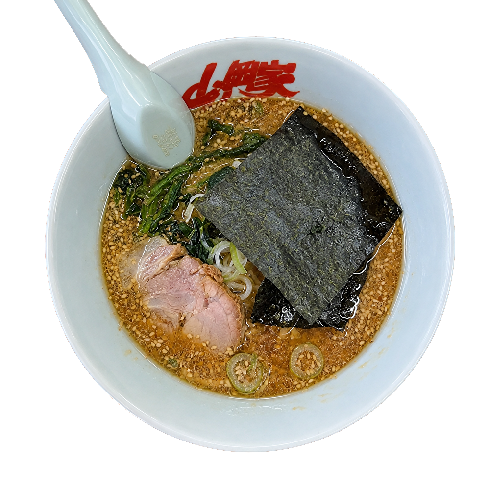
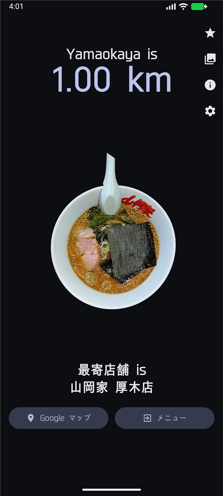
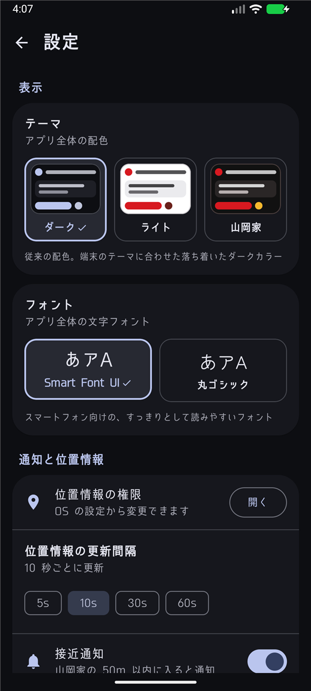
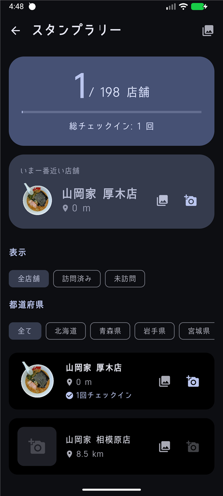
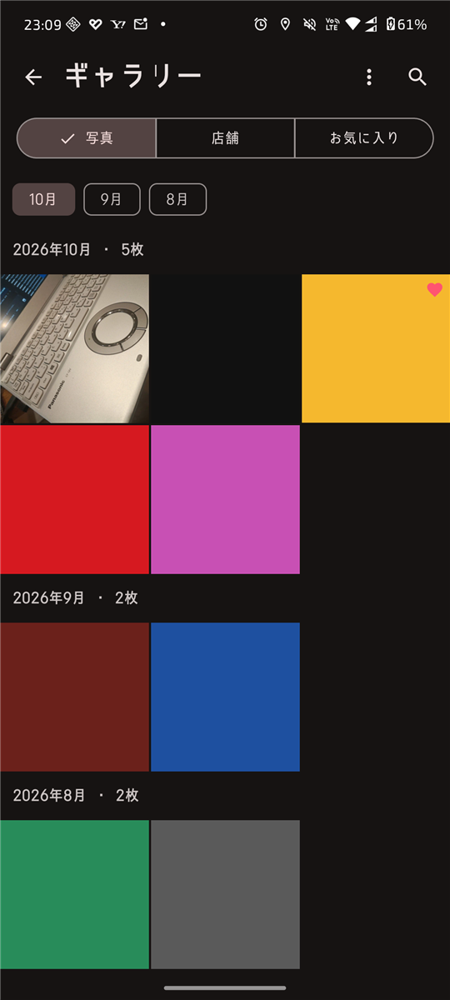

<p align="center">
  
</p>

<h1 align="center">Yamaokaya is Doko?</h1>

<p align="center">
  <strong>現在地から、最寄りの山岡家へ。</strong>
</p>

<p align="center">
  現在地から最寄りの「山岡家」までの距離と方角を表示する、ファン制作の非公式 Android アプリです。<br>
  33都道府県・198店舗の座標を内蔵し、Google Play Services に依存せずに動作します。位置情報から最寄り店舗を計算し、方位センサーに合わせて方角を示します。
</p>

<p align="center">
  <a href="https://github.com/koba9813/yamaokaya/releases/latest"></a>
  <a href="LICENSE"></a>
  
</p>

<p align="center">
  <a href="https://github.com/koba9813/yamaokaya/releases/latest"><strong>最新リリースをダウンロード</strong></a>
  ·
  <a href="#スクリーンショット">スクリーンショット</a>
  ·
  <a href="#開発">開発に参加</a>
</p>

## 目次

- [スクリーンショット](#スクリーンショット)
- [主な機能](#主な機能)
- [インストールと使い方](#インストールと使い方)
- [対応環境と権限](#対応環境と権限)
- [プライバシー](#プライバシー)
- [店舗データと制限](#店舗データと制限)
- [技術構成](#技術構成)
- [プロジェクト構成](#プロジェクト構成)
- [開発](#開発)
- [コントリビュート](#コントリビュート)
- [ライセンス](#ライセンス)

## スクリーンショット

主要な4画面です。画像はダークテーマで撮影しています。

| メイン画面 | 設定画面 |
|:---:|:---:|
|  |  |
| 最寄り店舗までの距離と方角。上部のアイコンから各機能を開けます。 | テーマ、フォント、通知、位置情報の更新間隔を設定できます。 |

| スタンプラリー | 写真ギャラリー |
|:---:|:---:|
|  |  |
| 訪問済み店舗数と合計チェックイン数、都道府県フィルター。 | 店舗名検索、並び替え、訪問写真の一覧。 |

## 主な機能

| 機能 | できること |
| --- | --- |
| 最寄り店舗と方角 | 現在地から登録店舗を計算し、店舗名・直線距離・方角を表示します。画面中央のラーメン画像が店舗の方向を指します。 |
| ルートと公式アプリ | Google マップのルート検索と、山岡家公式アプリを開けます（公式アプリ未インストール時は公式メニューページ）。 |
| 接近通知 | 店舗の近くで通知します。距離トラッカーを有効にすると、通知バーに最寄り店舗までの距離を表示します。 |
| スタンプラリー | 店舗でのチェックイン、訪問回数、進捗、都道府県・訪問状況での絞り込みに対応しています。 |
| 写真ギャラリー | アプリ内カメラで撮影した写真を整理できます。フルブリードのグリッド表示、店舗名検索・日付順／店舗順の並び替え・月ジャンプ、お気に入り、店舗別アルバム、複数選択削除、ピンチズーム、共有ができます。Instagram ストーリーにも共有でき、共有画像には「Yamaokaya is Doko?」の透かしが入ります。 |
| ホーム画面ウィジェット | 標準（4×2 基本、サイズに応じて small / wide / tall。wide は地図ボタン、tall は近い3店舗）、コンパクト（4×1）、ミニマル（2×2）の3種類があります。 |
| テーマとフォント | ダーク / ライト / 山岡家（赤・黒・金）の3テーマと、Smart Font UI / 丸ゴシック（Zen Maru Gothic）の2フォントを選べます。 |
| バックアップと復元 | 写真・スタンプ・設定を1つの ZIP に書き出し、「追加で読み込む」または「置き換え」で復元できます。共有シートで別の端末へ送ることもできます。 |
| アプリ内アップデート | 起動時または設定画面から最新版を確認し、APK をダウンロードしてインストールできます。新しいバージョンが公開されると通知でもお知らせします（定期チェック）。 |
| Information | 使い方・主な機能・権限の説明と、GitHub リポジトリ・山岡家公式サイト・公式アプリへのリンクをまとめて確認できます。 |

バックアップの「追加で読み込む」は現在のデータを残して取り込み、「置き換え」は写真・スタンプ・設定をバックアップの内容に置き換えます。

初期設定はダークテーマ / Smart Font UI で、接近通知と距離トラッカーは有効です。チェックインの距離・クールダウン、撮影条件などは[店舗データと制限](#店舗データと制限)にまとめています。

## インストールと使い方

### インストール

APK は [GitHub Releases](https://github.com/koba9813/yamaokaya/releases/latest) で公開しています。

1. 最新リリースの Assets にある APK をダウンロードします。
2. 端末の設定で「提供元不明のアプリ」のインストールを許可します。
3. ダウンロードした APK を開き、インストールします。
4. アプリを起動し、位置情報の利用を許可します。

アプリ内アップデートも GitHub Releases から APK を取得します。初回と同様に「提供元不明のアプリ」の許可を求められる場合があります。

### 基本の使い方

1. 起動して位置情報を許可すると、メイン画面に最寄り店舗までの距離と方角が表示されます。
2. 店舗の近くでは表示が「Yamaokaya is Koko」に変わり、チェックインできます。画面中央のラーメン画像が店舗の方向を指します。
3. 画面下部のボタンから、Google マップのルートや山岡家公式アプリを開けます。
4. 上部のアイコンから、スタンプラリー、写真ギャラリー、Information、設定を開けます。
5. 設定では、テーマ・フォント、接近通知、距離トラッカー、位置情報の更新間隔（5/10/30/60秒）を変更できます。

## 対応環境と権限

### 対応環境

| 項目 | 内容 |
| --- | --- |
| 対応 OS | Android 7.0（API 24）以上 |
| ビルド設定 | targetSdk 35 / compileSdk 35 |
| 表示言語 | 日本語 |
| Google Play Services | 不要 |
| インターネット | アップデート確認と APK ダウンロード（任意） |
| 方位センサー | 回転ベクトルセンサー（方角表示に使用、任意） |
| カメラ | アプリ内撮影に使用（任意） |

### 権限

| 権限・特別アクセス | 用途 | 必須/任意 |
| --- | --- | --- |
| 位置情報（正確 / おおよそ） | 最寄り店舗までの距離と方角を計算 | 必須 |
| バックグラウンド位置情報 | 距離トラッカーをバックグラウンドで継続利用 | 任意（端末設定） |
| 通知 | 接近通知・距離トラッカー・アップデート通知の表示 | 任意（Android 13 以上は実行時許可） |
| カメラ | 訪問写真の撮影 | 任意 |
| インターネット | アップデート確認・APK ダウンロード | 任意 |
| アプリのインストール | アプリ内アップデート | 任意 |

位置情報を許可しない場合、最寄り店舗の距離と方角は表示できません。おおよその位置情報のみを許可した場合、距離の精度は低下します。

カメラや通知を許可しなくても、写真の閲覧や設定など他の機能は利用できます。写真の追加はアプリ内カメラのみで、バックアップには SAF を使用するため、ストレージ権限は要求しません。

距離トラッカーはフォアグラウンドサービスとして動作し、通知領域に常時通知を表示します。バックグラウンドでの継続利用には、端末設定で位置情報を「常に許可」にすることが必要な場合があります（Android のバージョンや端末によります）。

## プライバシー

アプリ本体は、位置情報や写真をアプリ独自のサーバーへ送信しません。アカウント登録も不要です。

| データ | 扱い |
| --- | --- |
| 位置情報 | 端末内で最寄り店舗までの距離と方角の計算に使用します。アプリ独自のサーバーへは送信しません。 |
| 店舗データ | アプリ内に静的に収録しています。実行時に外部 API から取得しません。 |
| 写真・スタンプ・設定 | アプリ専用領域に保存します。Android の自動バックアップは無効です。 |
| バックアップ ZIP | ユーザーが選んだ保存先に作成します。共有先もユーザーが選択します。 |
| アカウント | 不要です。 |
| 広告・解析 | 広告 SDK、アクセス解析 SDK、Firebase は使用していません。 |

### ネットワーク通信

| 操作 | 通信・起動先 |
| --- | --- |
| 更新確認・APK ダウンロード | GitHub Releases（API / APK 配布。定期チェックを含む） |
| 山岡家公式アプリ・公式サイト | 公式アプリ起動、または yamaokaya.com（Custom Tabs） |
| ルート表示 | Google マップ（外部アプリまたはブラウザ） |
| 写真の共有 | ユーザーが選んだ共有先アプリ |

ルート表示では店舗の座標を Google マップに渡します。現在地をアプリから渡すことはありません。外部サービスを開いた後の情報の扱いは、各サービスの権限とプライバシーポリシーに従います。

## 店舗データと制限

### 店舗データ

- 店舗名・緯度経度・都道府県は、[`YamaokayaFinder.kt`](app/src/main/java/win/haya/doko/YamaokayaFinder.kt) に静的に定義しています。
- 33都道府県・198店舗を収録しています（実装時点）。
- アプリは店舗データを外部 API から取得せず、アプリ内の静的データのみを使用します。
- 店舗データの出典および最終更新日は、リポジトリ内に明記されていません。更新は静的リストの編集で行います。
- 扱うのは店舗名・座標・都道府県のみで、営業時間・メニュー・電話番号などの店舗詳細データは保持していません。

### 既知の制限

- **店舗データは静的です。** 新店・閉店・移転は自動反映されません。最新の営業時間・メニュー・臨時休業は公式情報を確認してください。
- **最寄り判定と距離。** 登録店舗の中から常に最寄りを表示します。距離は直線距離で、実際の道のりや所要時間ではありません。
- **方角表示。** 回転ベクトルセンサーを搭載しない端末では、端末の向きに追従した方角表示を利用できません。
- **チェックインと撮影。** チェックインとアプリ内カメラは店舗から50m以内で利用できます。チェックインは同一店舗3時間のクールダウンがあります。
- **接近通知。** 接近通知はアプリが位置情報を取得している間に動作します。アプリを終了した状態では、距離トラッカーを有効にした場合に限り、その常時通知が残ります（端末・OS の状態によります）。
- **ウィジェット。** 配色はテーマに連動せずライト固定です。更新は約30分ごと、またはアプリの位置情報更新時で、最後に取得した位置情報に基づきます（OS の制約により遅れる場合があります）。
- **アプリ内アップデート。** GitHub Releases の APK が対象です。異なる署名鍵で署名された APK には上書きできません。
- **アップデート通知。** 新しいバージョンの公開は最大12時間間隔の定期チェックで検知します。通知の許可がない場合や OS の省電力制約がある場合は届かないことがあります。

## 技術構成

| 分類 | 採用技術 |
| --- | --- |
| 言語 | Kotlin 2.0.0（Java 17 ターゲット） |
| UI | Jetpack Compose（BOM 2024.05.00）、Material 3 |
| 位置情報 | Android 標準 LocationManager（GPS / NETWORK_PROVIDER） |
| 方位 | SensorManager（回転ベクトルセンサー） |
| カメラ | CameraX 1.3.4 |
| 画像読み込み | Coil 2.6.0 |
| 非同期処理 | Kotlin Coroutines 1.8.1 |
| 定期処理 | WorkManager 2.9.1（アップデートの定期チェック） |
| ウィジェット | RemoteViews |
| 外部ブラウザ | AndroidX Browser（Custom Tabs）1.8.0 |
| データ保存 | SharedPreferences、アプリ専用ストレージ（写真は WebP） |
| ビルド | Gradle 8.13、AGP 8.7.3、JDK 21 |
| テスト | JUnit 4、Robolectric 4.12.2 |

単一の `MainActivity` 上に Compose で画面を構成し、画面の切り替えは Compose の状態で管理しています。位置情報と方位は `YamaokayaViewModel`、永続化は `SharedPreferences` とアプリ専用ストレージが担当します。データベースや外部バックエンドは使用していません。

## プロジェクト構成

| パス | 役割 |
| --- | --- |
| `app/src/main/java/win/haya/doko/` | Kotlin ソース（画面、位置情報、店舗データ、バックアップ、ウィジェット） |
| `app/src/main/res/` | レイアウト、画像、フォント、文字列などのリソース |
| `app/src/test/java/win/haya/doko/` | Robolectric を含むユニットテスト |
| `docs/screenshots/` | README 用スクリーンショット |
| `fastlane/metadata/android/` | ストア掲載用メタデータ（ja-JP / en-US） |
| `web/` | PWA 版のソース |
| `app/build.gradle.kts` | アプリ設定、依存関係、署名設定 |

## 開発

### 必要なもの

- JDK 21（動作確認済み。コンパイルターゲットは Java 17）
- Android SDK Platform 35
- Android Studio またはコマンドライン環境
- Gradle 8.13（同梱の Gradle Wrapper を使用）

### ビルド

```bash
git clone https://github.com/koba9813/yamaokaya.git
cd yamaokaya
./gradlew :app:assembleDebug
```

Windows では `gradlew.bat :app:assembleDebug` を使用します。デバッグ APK は `app/build/outputs/apk/debug/app-debug.apk` に出力されます。

`JAVA_HOME` を JDK 21 に向けてください。Android Studio で開く場合は、`local.properties` の `sdk.dir` が Android SDK を指していることを確認してください（Android Studio が自動生成します）。

接続済みの実機へインストールする場合は、`./gradlew :app:installDebug` を実行します。

### Windows での注意

`gradlew.bat` を使用してください。

日本語を含むパスでビルドする場合は、次のように文字コードを指定してください。

```powershell
$env:JAVA_TOOL_OPTIONS = "-Dfile.encoding=UTF-8"
```

日本語を含むパスではユニットテストが失敗することがあります。ASCII のみのパスにクローンするか、`subst` で ASCII のドライブを割り当てて実行してください。

### テスト

```bash
./gradlew :app:testDebugUnitTest
```

Robolectric を含むユニットテストが実行されます。店舗計算、位置情報、スタンプ、設定、バックアップ、ウィジェット描画などを対象としています。

### リリースビルド

リリース APK の署名は環境変数から設定します。値はリポジトリにコミットしないでください。

| 環境変数 | 用途 |
| --- | --- |
| `RELEASE_KEYSTORE_PATH` | キーストアファイルのパス |
| `RELEASE_KEYSTORE_PASSWORD` | キーストアのパスワード |
| `RELEASE_KEY_ALIAS` | キーのエイリアス |
| `RELEASE_KEY_PASSWORD` | キーのパスワード |

4つを設定してから、次のコマンドを実行します。

```bash
./gradlew :app:assembleRelease
```

署名済み APK は `app/build/outputs/apk/release/app-release.apk` に出力されます。環境変数が揃わない場合、リリース APK は署名されません（出力は `app-release-unsigned.apk`）。

## コントリビュート

- 不具合報告・機能要望は [GitHub Issues](https://github.com/koba9813/yamaokaya/issues) へお願いします。
- コード変更は [Pull Request](https://github.com/koba9813/yamaokaya/pulls) で受け付けています。店舗情報の追加・修正、UI の改善、不具合修正などを歓迎します。
- アプリ内の「設定 > サポート」からも Issue を作成できます。
- 変更後は[テスト](#テスト)を実行し、テストが通ることを確認してください。

## ライセンス

アプリのソースコードは [MIT License](LICENSE) で公開されています。

Copyright (c) 2026 Koba_9813

### 免責事項

本アプリは山岡家の公式アプリではなく、ファンによる非公式プロジェクトです。山岡家および関係各社とは関係ありません。店舗名・商標・ロゴなどの権利は、それぞれの権利者に帰属します。

店舗情報の正確性・最新性は保証しません。最新の営業時間・メニュー・臨時休業などは公式情報を確認してください。

画像・フォントなどの第三者素材と依存ライブラリには、それぞれのライセンスが適用されます。ライセンス全文を別ファイルとして同梱していない素材もあります。再配布・再利用の際は、各素材・ライブラリのライセンスを確認してください。

### クレジット

- ラーメン画像: Photo by Sagara（Special Thanks）
- フォント: Smart Font UI / Zen Maru Gothic
